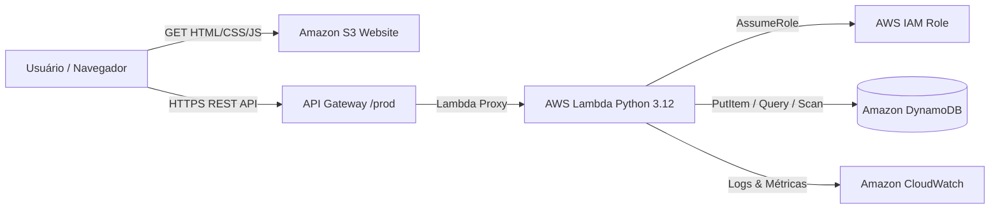

## 👥 Identificação Acadêmica, Mentoria e Ecossistema Tecnológico

| Papel no Projeto | Nome / Instituição | Links Oficiais e Redes |
| :--- | :--- | :--- |
| 👨‍🏫 **Professor / Mestre Avaliador** | **Ednilson Cipolla** | [](https://br.linkedin.com/in/ednilsoncipolla) |
| 👨‍💻 **Aluno / Cloud Analyst & Architect** | **Vagner Tomaz** | [](https://www.linkedin.com/in/vagner-tomaz) [](https://github.com/uvsanto/semana-arquitetura-aws) |
| 🏫 **Instituição e Gestora** | **Escola da Nuvem** | [](https://escoladanuvem.org/) [](https://www.instagram.com/escola_da_nuvem/) |

# 🧠 Jogo da Memória Serverless na AWS - Laboratório AWS


Aplicação web interativa desenvolvida e implantada com arquitetura **100% Serverless na AWS** (Região `sa-east-1` - São Paulo), integrando hospedagem estática, API REST gerenciada, computação orientada a eventos e banco de dados NoSQL de baixa latência.

---

## 🏗️ Arquitetura da Solução

```text
[ Navegador (Cliente) ]
       │
       ├──► GET (HTML/CSS/JS) ──► [ Amazon S3 (Static Website Hosting) ]
       │
       └──► HTTPS (REST API)  ──► [ Amazon API Gateway (Regional /prod) ]
                                          │
                                          ▼ (Lambda Proxy Integration)
                                  [ AWS Lambda (Python 3.12) ]
                                          │
                                          ├──► IAM Role (Princípio do Menor Privilégio)
                                          │
                                          ▼ (boto3 SDK)
                                  [ Amazon DynamoDB (On-Demand) ]
```


## 📋 Descrição Didática do Desafio

Implantar uma arquitetura **100% Serverless na AWS** (Região `sa-east-1` — São Paulo) para disponibilizar um Jogo da Memória na nuvem, desacoplando a camada de apresentação da lógica de negócios e persistência, permitindo armazenar e consultar os resultados das partidas em tempo real sem gerenciar servidores.

### Objetivos Propostos
* Hospedar aplicação web estática de alta disponibilidade.
* Criar backend orientado a eventos sem servidores (*Serverless*).
* Persistir resultados e histórico em banco de dados NoSQL gerenciado.
* Implementar APIs REST seguras com suporte a requisições *cross-origin* (CORS).
* Aplicar boas práticas de arquitetura, segurança e governança de custos (FinOps) na AWS.

---

## 🏗️ Visão Geral do Ambiente (Baseline)

### Estado Inicial (AS-IS)

| Componente | Estado Inicial | Limitação Técnica |
| :--- | :--- | :--- |
| **Frontend** | Local (`HTML/CSS/JS`) | Execução restrita à máquina local do usuário. |
| **Persistência** | `localStorage` do navegador | Dados voláteis, sem compartilhamento ou ranking global. |
| **Backend** | Simulado no cliente | Ausência de validação centralizada e regras de negócio no servidor. |
| **APIs** | Simuladas localmente | Sem endpoints HTTP/REST expostos para integração. |
| **Monitoramento** | Não existente | Sem logs centralizados, rastreabilidade ou métricas de execução. |

### Estado Final (TO-BE)

| Camada | Solução AWS | Função Arquitetural |
| :--- | :--- | :--- |
| **Frontend** | **Amazon S3** | Hospedagem de site estático (*Static Website Hosting*). |
| **Borda / API** | **Amazon API Gateway** | Exposição de API REST Regional (`/prod`) com CORS e integração proxy. |
| **Backend** | **AWS Lambda** | Processamento *serverless* em Python 3.12 (`boto3`). |
| **Persistência** | **Amazon DynamoDB** | Banco NoSQL *On-Demand* com chave primária composta (`PK` + `SK`). |
| **Observabilidade** | **Amazon CloudWatch** | Coleta nativa de logs de invocação e métricas de execução. |
| **Segurança** | **AWS IAM** | Role de execução aplicando o Princípio do Menor Privilégio. |


---

## 📸 Evidências da Implantação

* **Tabela NoSQL (Amazon DynamoDB):** [`Docs/DynamoDB- Pint 1.png`](Docs/DynamoDB-%20Pint%201.png)
* **Backend Serverless (AWS Lambda):** [`Docs/Teste Lambda 02.png`](Docs/Teste%20Lambda%2002.png)
* **Endpoints REST (Amazon API Gateway):** [`Docs/API Gateway_02.png`](Docs/API%20Gateway_02.png)
* **Hospedagem Estática (Amazon S3):** [`Docs/memory-game-lab-vagner-santos_final.png`](Docs/memory-game-lab-vagner-santos_final.png)


---

## 📐 Decisões de Arquitetura (ADRs)

### ADR-01 — Hospedagem do Frontend
* **Decisão:** Utilizar **Amazon S3 Static Website Hosting** com política de leitura pública controlada (`s3:GetObject`).
* **Justificativa:** Baixo custo, alta durabilidade/disponibilidade nativa e simplicidade operacional para entrega de ativos estáticos (`HTML`, `CSS`, `JS`).

### ADR-02 — Persistência de Dados NoSQL
* **Decisão:** Utilizar **Amazon DynamoDB** em modo de capacidade **On-Demand**, modelado com chave primária composta:
  * **Partition Key (`playerId`):** Hash MD5 do nome do jogador em minúsculas (evita *hot partitions* e padroniza buscas).
  * **Sort Key (`gameId`):** Identificador único `UUIDv4` por partida.
* **Justificativa:** Escalabilidade automática para cargas intermitentes sem necessidade de provisionamento prévio de RCUs/WCUs, garantindo gravações diretas (`PutItem`) e consultas eficientes por jogador (`Query`).

### ADR-03 — Camada de Computação Backend
* **Decisão:** Utilizar **AWS Lambda** (Runtime Python 3.12, 128 MB de memória) inicializando o cliente `boto3` fora do `lambda_handler`.
* **Justificativa:** Arquitetura orientada a eventos com cobrança estritamente por tempo de execução (*pay-as-you-go*) e reaproveitamento de conexões entre invocações (*Warm Starts*).

### ADR-04 — Exposição de APIs e Integração
* **Decisão:** Utilizar **Amazon API Gateway** (REST API Regional) com **Lambda Proxy Integration** e métodos `OPTIONS` habilitados.
* **Justificativa:** Integração nativa que repassa o payload HTTP bruto ao Lambda e permite controle granular de cabeçalhos CORS (`Access-Control-Allow-Origin`) nas rotas `POST /resultado`, `GET /ranking` e `GET /jogador/{nome}`.

---

## 🔄 Topologia Operacional e Observabilidade



---

## 🎓 Alinhamento e Cobertura AWS SAA-C03

| Domínio do Exame SAA-C03 | Cobertura | Aplicação Prática no Laboratório |
| :--- | :---: | :--- |
| **Arquiteturas Resilientes** | **Alta** | Uso de serviços gerenciados Multi-AZ nativos (S3, API Gateway, Lambda, DynamoDB) sem ponto único de falha. |
| **Arquiteturas Seguras** | **Alta** | Aplicação do Princípio do Menor Privilégio no IAM (`STS AssumeRole`), CORS controlado e sanitização de credenciais. |
| **Arquiteturas de Alta Performance** | **Média** | Otimização de *Warm Starts* no Lambda, particionamento uniforme via MD5 no DynamoDB e endpoint Regional em `sa-east-1`. |
| **Arquiteturas Otimizadas em Custos** | **Alta** | Modelo 100% *Serverless* (*zero idle cost*), DynamoDB *On-Demand* e desprovisionamento completo pós-teste. |

### Fundamentos Exercitados
* **Amazon S3:** Static Website Hosting, Block Public Access e Bucket Policies.
* **Amazon API Gateway:** REST APIs, Path Parameters (`{nome}`), Lambda Proxy Integration e Preflight CORS (`OPTIONS`).
* **AWS Lambda:** Ciclo de vida de execução (*Cold* vs. *Warm Start*), variáveis/clientes globais e integração SDK `boto3`.
* **Amazon DynamoDB:** Chave Primária Composta (`PK` + `SK`), operações `PutItem`, `Query` vs. `Scan` e capacidade *On-Demand*.
* **AWS CloudWatch & IAM:** Observabilidade nativa e políticas baseadas em identidade restritas a recursos específicos.

---

## 🏛️ Governança e Frameworks Aplicados

### 1. Princípios do AWS Well-Architected Framework

| Pilar Well-Architected | Maturidade | Práticas Validadas |
| :--- | :---: | :--- |
| **Excelência Operacional** | 75% | Logs centralizados no CloudWatch, documentação arquitetural e *troubleshooting* estruturado. |
| **Segurança** | 80% | Política IAM inline restrita ao ARN da tabela e controle de origem via CORS. |
| **Confiabilidade** | 85% | Infraestrutura gerenciada com redundância Multi-AZ nativa e tratamento de exceções no Python. |
| **Eficiência de Performance** | 75% | Reaproveitamento de conexão `boto3` (*Warm Start*) e chaves hash MD5 no DynamoDB. |
| **Otimização de Custos** | 90% | Arquitetura sem ociosidade (*pay-per-request*) e limpeza total dos recursos após validação. |
| **Sustentabilidade** | 85% | Computação efêmera sob demanda, eliminando instâncias EC2 subutilizadas 24/7. |

> **Maturidade Geral Estimada:** **81,7%**

### 2. Conformidade com a LGPD (Lei Geral de Proteção de Dados)
* **Minimização de Dados:** Coleta restrita ao apelido/nome informado pelo jogador e métricas da partida, sem dados sensíveis.
* **Pseudonimização:** Conversão do nome do jogador em hash MD5 (`playerId`) para indexação na chave de partição.
* **Controle de Acesso e Rastreabilidade:** Acesso ao banco restrito à role do Lambda e auditoria de operações via CloudWatch Logs.
* **Transparência Técnica (Nota de Segurança):** As chamadas à API trafegam criptografadas via **HTTPS (TLS)** no API Gateway. O frontend estático no S3 opera em **HTTP** por limitação nativa do *Static Website Hosting* (adequado ao escopo de dados públicos do laboratório; em produção, utiliza-se **Amazon CloudFront** para HTTPS ponta a ponta).

> **Conformidade Geral Estimada:** **70%**

### 3. AWS Cloud Adoption Framework (AWS CAF)

| Perspectiva AWS CAF | Cobertura | Evidência no Projeto |
| :--- | :---: | :--- |
| **Negócios** | 70% | Entrega ágil de MVP funcional com custo operacional próximo a zero. |
| **Pessoas** | 75% | Capacitação prática em arquitetura *serverless*, Python e documentação técnica. |
| **Governança** | 80% | Padronização de nomenclatura de recursos e ciclo de vida controlado (criação $\rightarrow$ teste $\rightarrow$ exclusão). |
| **Plataforma** | 90% | Adoção completa de serviços gerenciados e desacoplados na nuvem AWS. |
| **Segurança** | 80% | Segregação de permissões via IAM Role e ausência de credenciais *hardcoded*. |
| **Operações** | 75% | Monitoramento via CloudWatch e validação ponta a ponta de endpoints. |

> **Cobertura Geral Estimada:** **78,3%**

---

## 📊 Operação, Monitoramento e Otimização (FinOps)

### Monitoramento Atual
* **CloudWatch Logs:** Acompanhamento de invocações do Lambda (`/aws/lambda/LambdaMemoryGame-Vagner-Santos`), latência (`Duration`) e consumo de memória.
* **Métricas API Gateway & DynamoDB:** Monitoramento de requisições HTTP (`2XX`, `4XX`, `5XX`) e consumo de unidades de leitura/gravação *On-Demand*.
* **Governança de Custos (FinOps):** Encerramento ordenado de todos os recursos (S3, API Gateway, Lambda, CloudWatch Logs, DynamoDB e IAM Role) imediatamente após a coleta das evidências, garantindo **custo zero** pós-laboratório.

### Evoluções Operacionais Futuras
* Configurar alertas proativos no **AWS Budgets** e análise granular no **AWS Cost Explorer**.
* Implementar alarmes no **CloudWatch** para taxas de erro (`5XXError`) e latência elevada no API Gateway.
* Definir políticas de retenção de logs (ex.: 7 ou 30 dias) no CloudWatch para evitar acúmulo indefinido de armazenamento.

---

## 🚀 Roadmap de Melhorias e Boas Práticas

### Evolução Recomendada (Do Laboratório para Produção)

1. **Segurança e Borda:**
   * Adicionar **Amazon CloudFront** com **Origin Access Control (OAC)** na frente do bucket S3, bloqueando o acesso público direto ao bucket e habilitando **HTTPS** com certificado SSL/TLS.
   * Proteger o API Gateway e o CloudFront com **AWS WAF** e regras de *throttling* (limitação de taxa de requisições).
   * Utilizar **AWS KMS** para criptografia gerenciada e **AWS Secrets Manager** caso sejam integrados serviços externos.
2. **Performance e Escala de Dados:**
   * Substituir a operação `Scan` na rota `/ranking` por um **Global Secondary Index (GSI)** no DynamoDB utilizando estratégia de *bucketing* (chave de partição fixa por período + pontuação como *Sort Key*), permitindo consultas ordenadas via `Query` em milissegundos.
   * Habilitar cache de resposta no **API Gateway** para o endpoint `/ranking`.
3. **Confiabilidade e Resiliência:**
   * Ativar **Point-in-Time Recovery (PITR)** e backups automatizados na tabela DynamoDB.
   * Evoluir para replicação **Multi-Region** (DynamoDB Global Tables) em cenários de alcance global.

### Papel de IaC (Terraform, CloudFormation ou AWS CDK) neste Cenário

Neste laboratório, os recursos foram provisionados manualmente via Console AWS para fins didáticos de fixação dos serviços e permissões. Em um ambiente corporativo ou de produção, recomenda-se fortemente o uso de **Infraestrutura como Código (IaC)** utilizando **Terraform**, **AWS CloudFormation** ou **AWS CDK**:

* **Infraestrutura Versionada:** Todo o provisionamento (S3, políticas, API Gateway, Lambda, DynamoDB e IAM) fica registrado em código no Git com histórico de alterações.
* **Reprodutibilidade:** Capacidade de replicar ambientes idênticos (`dev`, `staging`, `prod`) em minutos sem divergências de configuração (*configuration drift*).
* **Automação (CI/CD):** Integração com pipelines (GitHub Actions / AWS CodePipeline) para testes e deploy automatizado de código e infraestrutura.
* **Auditoria e Conformidade:** Revisão de segurança estática antes do deploy e eliminação de erros manuais operacionais (como falhas de configuração de CORS ou políticas IAM).

  ## 🛠️ Serviços AWS Utilizados

* **Amazon S3:** Hospedagem de site estático (*Static Website Hosting*) com política de bucket para leitura pública (`s3:GetObject`) entregando o frontend em HTML5, CSS3 e JavaScript puro.
* **Amazon API Gateway:** API REST Regional (`prod`) com suporte a **CORS** e **Integração de Proxy do Lambda** expondo três endpoints:
  * `POST /resultado` — Registra a pontuação, tentativas e tempo da partida.
  * `GET /ranking` — Consulta e ordena o Top 10 melhores pontuações.
  * `GET /jogador/{nome}` — Busca o histórico de partidas de um jogador específico usando parâmetro de caminho dinâmico.
* **AWS Lambda:** Função em **Python 3.12** utilizando `boto3` para validação de payload, geração de identificadores (`UUIDv4` e hash `MD5` para `playerId`) e operações no DynamoDB.
* **Amazon DynamoDB:** Tabela NoSQL em modo **On-Demand** utilizando chave primária composta:
  * **Partition Key (`playerId`):** Hash MD5 do nome do jogador (distribuição uniforme de partições).
  * **Sort Key (`gameId`):** UUID único da partida (permite múltiplas partidas por jogador e consultas eficientes via `Query`).
* **AWS IAM:** Role de execução dedicada com política em linha restrita apenas às ações necessárias (`dynamodb:PutItem`, `dynamodb:GetItem`, `dynamodb:Scan`, `dynamodb:Query`) sobre a tabela específica do projeto, além do envio de logs ao **Amazon CloudWatch**.

---

## 🐛 Troubleshooting & Lições Aprendidas na Prática

Durante a implantação e os testes de integração ponta a ponta, foram diagnosticados e resolvidos pontos críticos reais de arquitetura:
1. **Permissões IAM (Least Privilege):** Correção de erro `AccessDeniedException` ao vincular a IAM Role customizada à função Lambda no lugar da role padrão de execução.
2. **Integração Proxy & CORS:** Configuração explícita de cabeçalhos `Access-Control-Allow-Origin` tanto no API Gateway (métodos `OPTIONS`) quanto nas respostas JSON retornadas pelo Lambda.
3. **Configuração Frontend x Backend:** Sincronização do endpoint de produção do API Gateway no arquivo `js/config.js` e controle de cache do navegador durante atualizações de artefatos estáticos no S3.
4. **Governança de Custos:** Desprovisionamento ordenado de todos os recursos (S3, API Gateway, Lambda, CloudWatch Logs, DynamoDB e IAM Role) após a validação e coleta de evidências.

---

## 📁 Estrutura do Projeto

```text
├── Docs/            # Evidências de arquitetura e implantação na AWS
├── assets/          # Recursos estáticos
├── css/             # Estilização da interface (style.css)
├── js/              # Lógica do jogo (game.js) e endpoint da API (config.js)
├── lambda/          # Código fonte da função serverless (lambda_function.py)
└── index.html       # Página principal da aplicação
```

---

## ✅ Conclusão

A arquitetura *serverless* implantada utilizando **Amazon S3**, **Amazon API Gateway**, **AWS Lambda** e **Amazon DynamoDB** atendeu integralmente aos requisitos funcionais e não funcionais do desafio, proporcionando escalabilidade automática, alta disponibilidade nativa e otimização máxima de custos. O projeto consolida os fundamentos práticos exigidos para a certificação **AWS Certified Solutions Architect — Associate (SAA-C03)** e segue os pilares do **AWS Well-Architected Framework**.

---


